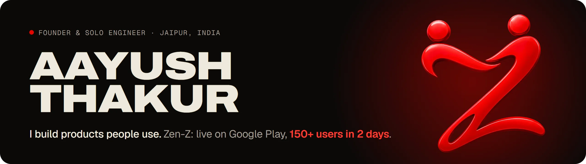
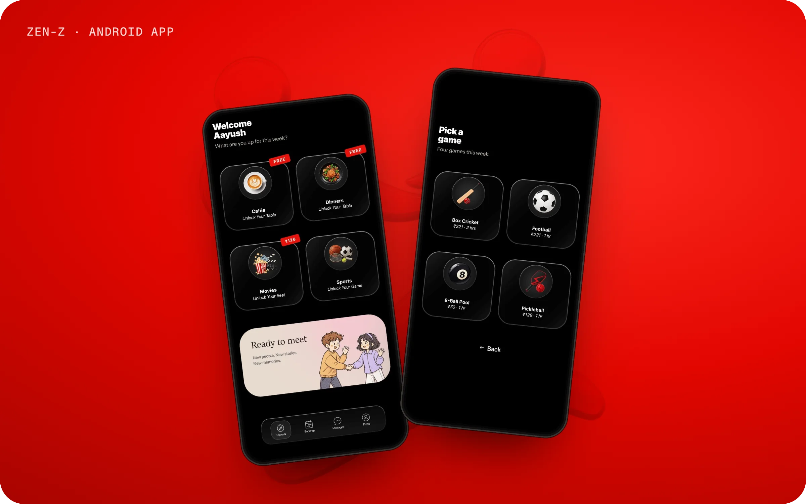
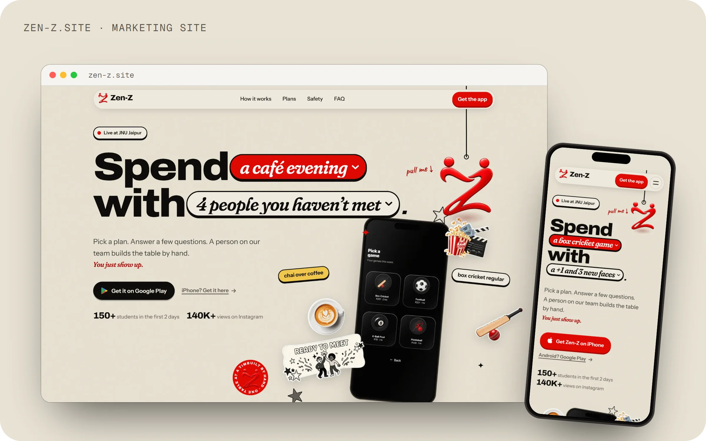
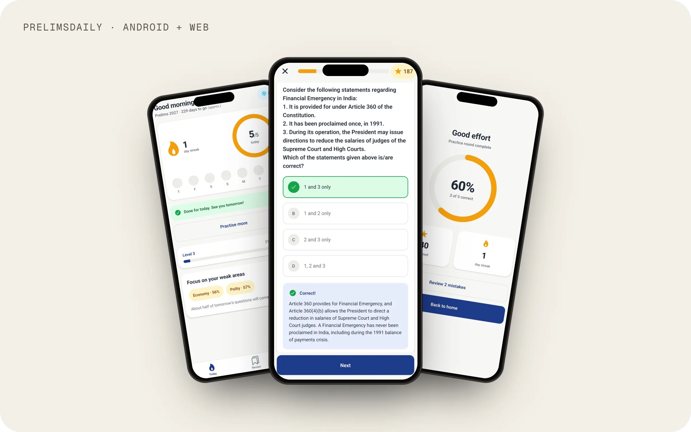
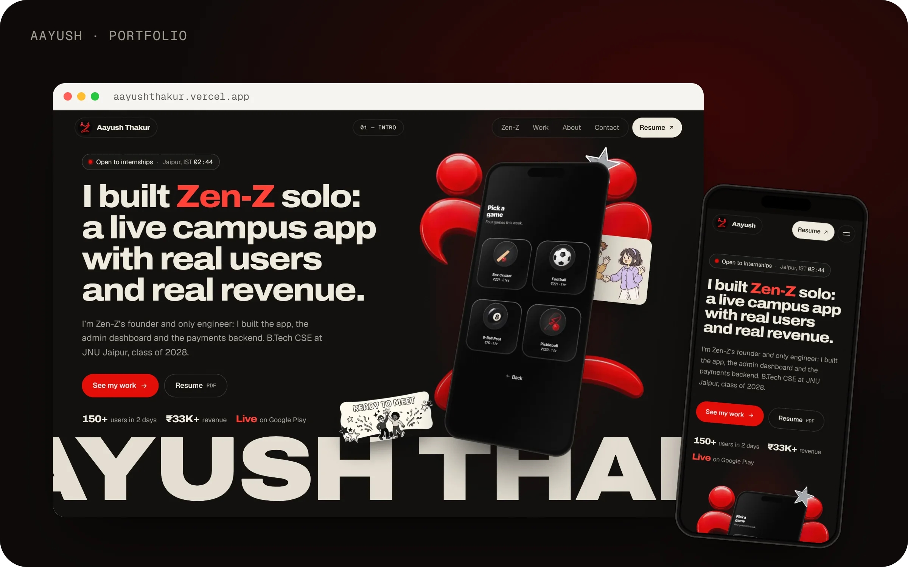

<a href="https://aayushthakur.vercel.app">
  <picture>
    <source media="(prefers-color-scheme: dark)" srcset="assets/banner-dark.webp">
    <source media="(prefers-color-scheme: light)" srcset="assets/banner-light.webp">
    
  </picture>
</a>

I'm the founder and solo engineer of **[Zen-Z](https://zen-z.site)**, a campus app live on Google Play. 
B.Tech CSE at JNU Jaipur, class of 2028. 
Open to remote or Jaipur internships in full-stack, mobile and AI/product engineering.

### Featured work

<table>
  <tr>
    <td width="50%" valign="top">
      
       <b>Zen-Z</b>: puts college students into small groups for cafés, dinners, movies and sports. 150+ users in 2 days.
       <a href="https://play.google.com/store/apps/details?id=com.campussocial.app">Google Play</a> · <a href="https://github.com/aayush-t-exe/Zen-Z">Code</a> · <a href="https://aayushthakur.vercel.app/work/zen-z">Case study</a>
    </td>
    <td width="50%" valign="top">
      
       <b>zen-z.site</b>: the marketing site, redesigned. A red Z you can pull; 27 contract checks guard payments.
       <a href="https://zen-z.site">Live</a> · <a href="https://aayushthakur.vercel.app/work/zen-z#website">How it's built</a>
    </td>
  </tr>
  <tr>
    <td width="50%" valign="top">
      
       <b>PrelimsDaily</b>: a UPSC daily-practice app, built in 1 day. Streaks, smart reminders, works offline, 72 tests.
       <a href="https://github.com/aayush-t-exe/prelims-daily">Code</a> · <a href="https://aayushthakur.vercel.app/work/prelimsdaily">Case study</a>
    </td>
    <td width="50%" valign="top">
      
       <b>Portfolio</b>: Next.js 16, GSAP and Lenis. A CSS-3D phone running Zen-Z travels through the page.
       <a href="https://aayushthakur.vercel.app">Live</a> · <a href="https://github.com/aayush-t-exe/portfolio">Code</a>
    </td>
  </tr>
</table>

### Stack

### Contact

**[Portfolio](https://aayushthakur.vercel.app)** · **[LinkedIn](https://www.linkedin.com/in/aayushthakurdev)** · **[Email](mailto:aayushthakur8002@gmail.com)** · **[Resume (PDF)](https://aayushthakur.vercel.app/Aayush_Thakur_Resume.pdf)**
